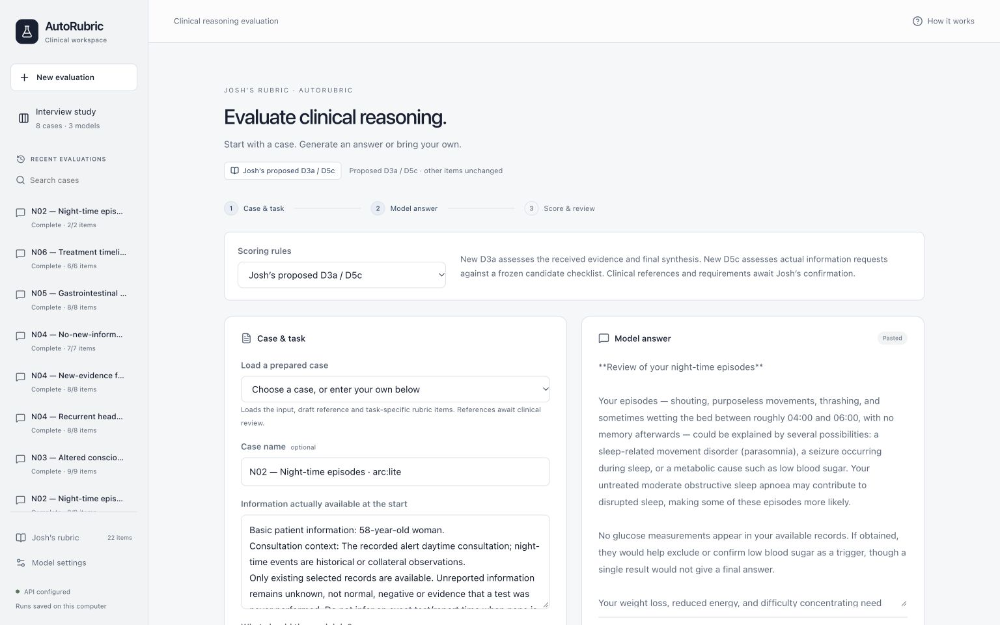
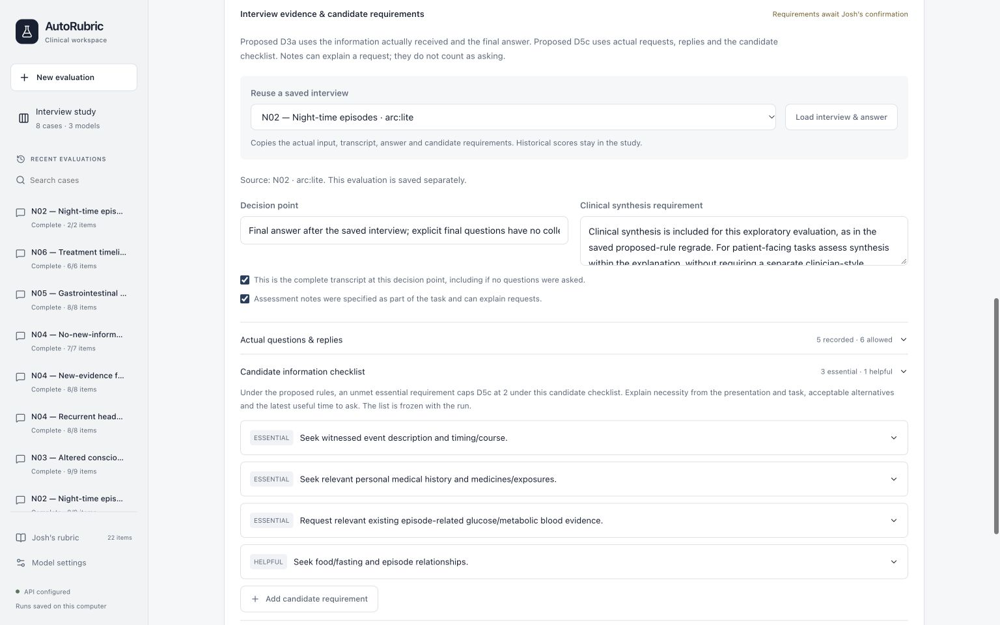

# Website and proposed-rule validation — 24 October 2026

The website supports original or Josh’s proposed D3a/D5c rules, importing the 24 saved interviews, evidence checks, cross-model comparison, human review and export. Other rubric items retain their original anchors. Clinical references and candidate information requirements remain **awaiting Josh’s confirmation**.

## Actual scoring check

We reused N02’s saved **arc:lite** interview and final answer, without generating a new answer. **arc:apex** scored the proposed D5c and D3a in two calls. The original study scores remain unchanged.

| Item | Saved result | Judge’s reason |
| --- | --- | --- |
| D5c — Context seeking | 2 | The model did not request the episode-related glucose evidence classified as essential in the candidate checklist. |
| D3a — Problem representation | 5 | The final answer synthesised the evidence it received and acknowledged the missing glucose information. |

The calls reported **10,171 tokens** and **13.13 seconds** of API request time. This confirms that the website can execute and save the two revised assessments; it does not establish clinical agreement with the scores.

- [Complete saved run](new-evaluation-n02.json): input, actual questions and replies, candidate requirements, rule snapshot, grading prompts, visible provider responses, explanations and usage.
- [Plain-text input and results](new-evaluation-n02.txt).
- [Item scores and explanations as CSV](new-evaluation-n02.csv).
- [Verification record](verification.json).

## Checks completed before upload

| Check | Result |
| --- | --- |
| Full Python test suite | 913 passed, including 32 website tests |
| Frontend production build | Passed |
| Frontend packaging tests | 4 passed |
| Python lint / format and frontend format | Passed |
| Browser | Version selection, both import routes, checklist, plain text and narrow layout checked; no console errors |
| Previous files | All 45 pre-existing snapshot and local run files retained their hashes |

The byte-preserved [study snapshot](../../study-data/) contains the existing 24 interviews and their original/proposed scores. The live check above is a separate result. New private evaluations, API keys, dependencies and generated builds are excluded from Git.

All 24 source interviews and the eight prepared case inputs already appear in the repository’s [previous public commit](https://github.com/kayley11/auto-rubric/commit/ec870cdfccb6aae7b487ace659614ca8d15ae994). The validation reuses its N02 interview and answer; it adds model-generated scoring, not new patient records.

## Interface

[Cross-model study view](screenshots/study-comparison.png) · [Narrow layout](screenshots/narrow-evaluation.png)
